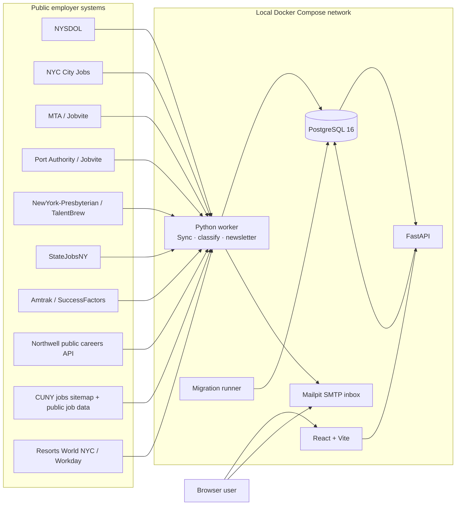
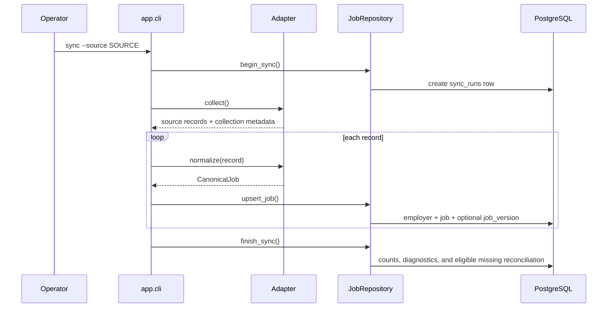
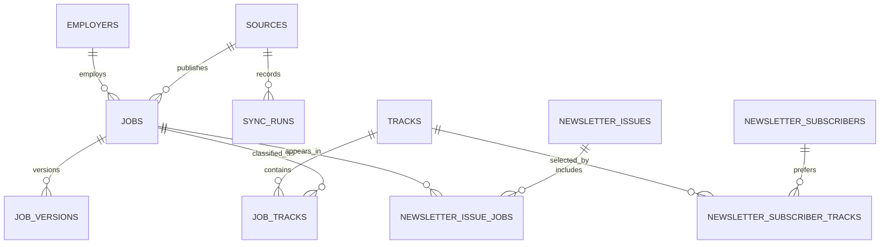
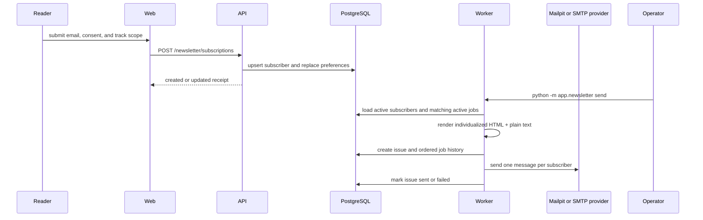

# Job Tracks architecture

This document is the source of truth for the system currently implemented in
this repository. It describes what runs, where the code lives, how data moves,
how to operate the local pilot, and which boundaries would need to change for a
production deployment.

Last verified: August 10, 2026.

## 1. System purpose

Job Tracks collects public job postings from multiple employers, normalizes
them into one PostgreSQL model, assigns occupational tracks, serves the catalog
through a typed API, presents it in a searchable website, stores newsletter
preferences, and sends individualized weekly opportunity digests over SMTP.

The current pilot implements ten live sources:

- New York State Department of Labor apprenticeship announcements
- NYC City Jobs
- Metropolitan Transportation Authority
- Port Authority of New York and New Jersey
- NewYork-Presbyterian
- StateJobsNY
- Amtrak
- Northwell Health
- CUNY
- Resorts World New York City

Additional providers are seeded in `sources` as future candidates, but a source
is not operational until it has an adapter registered in `app/adapters/__init__.py`.

## 2. Runtime architecture



All host ports bind to `127.0.0.1`; none are exposed on the LAN by default.

| Service | Responsibility | Container port | Current host address |
| --- | --- | ---: | --- |
| `postgres` | Canonical jobs, tracks, subscribers, sync and issue history | 5432 | `127.0.0.1:5433` |
| `api` | Typed HTTP catalog and newsletter signup | 8000 | `http://localhost:8000` |
| `web` | Search UI, job files, and newsletter signup | 5173 | `http://localhost:4000` |
| `mailpit` | Development SMTP capture and email preview | 1025 / 8025 | SMTP `127.0.0.1:1026`; UI `http://localhost:8026` |
| `worker` | On-demand ingestion, classification, rendering, and delivery | n/a | Invoked with `docker compose run` |
| `migrate` | Applies ordered SQL migrations once | n/a | Invoked with `docker compose run` |

`WEB_PORT` defaults to `4000`. If a local machine selects another port,
`API_CORS_ORIGINS` and `SITE_URL` must be updated to the same browser origin.

## 3. Repository map

```text
ula-demo/
├── app/
│   ├── adapters/
│   │   ├── base.py                 Shared adapter contract
│   │   ├── nysdol.py               NYSDOL normalization adapter
│   │   ├── nysdol_scraper.py       NYSDOL HTTP collection and HTML parsing
│   │   ├── nyc_jobs.py             NYC SmartRecruiters adapter
│   │   ├── mta.py                  MTA public Jobvite adapter
│   │   ├── port_authority.py       Port Authority Jobvite adapter
│   │   ├── newyork_presbyterian.py NYP TalentBrew adapter
│   │   ├── statejobsny.py          StateJobsNY public vacancy adapter
│   │   ├── amtrak.py               Amtrak SuccessFactors adapter
│   │   ├── northwell.py             Northwell public careers API adapter
│   │   ├── cuny.py                  CUNY sitemap and job-data adapter
│   │   ├── resorts_world.py         Resorts World Workday adapter
│   │   └── public_web.py           Shared rate-limited HTML/JSON client
│   ├── api/
│   │   ├── main.py                 FastAPI factory, middleware, error handling
│   │   ├── routes.py               Versioned HTTP routes
│   │   ├── models.py               Pydantic request/response contracts
│   │   ├── repository.py           Read-only catalog queries
│   │   ├── newsletter_repository.py Subscriber-preference writes
│   │   └── dependencies.py         Per-request repository construction
│   ├── newsletter/
│   │   ├── __main__.py             Preview/send command line interface
│   │   ├── models.py               Internal digest records
│   │   ├── repository.py           Subscriber/job reads and issue history
│   │   ├── renderer.py             HTML and plain-text email rendering
│   │   └── mailer.py               SMTP message construction and delivery
│   ├── classification.py           Deterministic occupational-track rules
│   ├── cli.py                      Sync, import, and classify commands
│   ├── config.py                   Environment-backed database settings
│   ├── domain.py                   Canonical job model and content hashing
│   └── repository.py               Ingestion persistence and lifecycle logic
├── db/
│   ├── migrations/                 Ordered, transactional PostgreSQL changes
│   └── README.md                   Database operator notes
├── docs/
│   ├── ARCHITECTURE.md             This system-level source of truth
│   ├── API.md                      Endpoint and contract reference
│   ├── CANONICAL_JOB_CONTRACT.md   Normalized field definitions
│   └── CLASSIFICATION.md           Track taxonomy and rule behavior
├── tests/
│   ├── api/                        API model, route, query, and DB tests
│   └── test_*.py                   Adapter, domain, classifier, email tests
├── web/
│   ├── src/api/                    Generated OpenAPI types and typed client
│   ├── src/components/             Shared site components
│   ├── src/lib/                    Formatting and URL-state helpers
│   ├── src/pages/                  Index, job detail, signup, and 404 pages
│   ├── src/test/                   Frontend fixtures and test setup
│   └── README.md                   Frontend-specific commands
├── COMMANDS.md                     Copy/paste operational command reference
├── README.md                       Project entry point
├── docker-compose.yml              Local service topology
├── Dockerfile                      Python API/worker image
└── pyproject.toml                  Pinned Python dependencies and package config
```

## 4. Ingestion and job lifecycle

The worker is deliberately on demand; there is no scheduler in the pilot.



Every adapter implements three operations defined by `JobSourceAdapter`:

- `collect()` retrieves live source records without writing to PostgreSQL.
- `load_export()` reads a previously saved source export.
- `normalize()` converts one source record into `CanonicalJob`.

`CanonicalJob.content_hash` covers material fields only. An unchanged source
record updates observation timestamps without creating a new version. A
material change updates `jobs` and appends a normalized snapshot to
`job_versions`.

Listing-only syncs preserve previously stored detail fields. Limited runs,
imports, failed runs, and count-mismatched runs never reconcile missing jobs.
Only a complete successful live snapshot can increment missing counters. A job
is marked removed after three complete misses and at least 48 hours of grace.

### Add another source

1. Add or enable its `sources` row through a migration.
2. Implement `JobSourceAdapter` under `app/adapters/`.
3. Register the class in `app/adapters/__init__.py`.
4. Normalize into `CanonicalJob`; do not add source-specific columns casually.
5. Add deterministic parser and normalization tests.
6. Run a limited sync, then a complete sync and inspect `sync_runs`.
7. Extend classification source maps only when the provider exposes a stable
   native category.

## 5. Occupational-track classification

Classification is a separate explicit step after ingestion:

```text
jobs → source-category mappings + title/description rules
     → ranked candidates
     → one primary and optional secondary assignments
     → job_tracks
```

The classifier is deterministic and versioned. Each assignment stores its
confidence, method, reason, taxonomy version, and review status. Low-confidence
or ambiguous results are marked `needs_review`. Automated classification never
overwrites a job that has a human assignment.

The authoritative behavioral detail is in
[`CLASSIFICATION.md`](CLASSIFICATION.md).

## 6. Database model



Table responsibilities:

| Table | Purpose |
| --- | --- |
| `sources` | Provider configuration, enabled state, adapter version, health |
| `employers` | Deduplicated normalized employer identities |
| `jobs` | Current canonical representation of every posting |
| `job_versions` | Append-only snapshots for material job changes |
| `tracks` | Versioned occupational taxonomy |
| `job_tracks` | Primary/secondary classification assignments and evidence |
| `sync_runs` | Per-source attempt counts, status, and diagnostics |
| `newsletter_subscribers` | Private email, status, consent time, and scope |
| `newsletter_subscriber_tracks` | Selected tracks for focused subscribers |
| `newsletter_issues` | Render/send status, counts, hash, and failures |
| `newsletter_issue_jobs` | Ordered job membership for a sent issue |

Migrations are named `NNNN_description.sql`, run once in lexical order inside
transactions, and are recorded in `schema_migrations`. Never modify an applied
migration; add the next numbered file.

## 7. HTTP API

FastAPI publishes an OpenAPI document at `/openapi.json` and interactive docs
at `/docs`. Pydantic models validate all public requests and responses.

Catalog endpoints are read-only:

- `GET /api/v1/health`
- `GET /api/v1/jobs`
- `GET /api/v1/jobs/{job_id}`
- `GET /api/v1/tracks`
- `GET /api/v1/sources`
- `GET /api/v1/stats`

The only public write is:

- `POST /api/v1/newsletter/subscriptions`

The catalog repository sets PostgreSQL `default_transaction_read_only=on`.
Signup uses a separate repository limited in code to normalized, consented
subscriber preference upserts. No endpoint lists subscribers or retrieves one
by email.

Internal raw payloads, classification reasons, and reviewer identities are
excluded from public response models. Full endpoint details are in
[`API.md`](API.md).

## 8. Website

The website is a React 19 and TypeScript application using Vite, React Router,
TanStack Query, and a generated TypeScript representation of the FastAPI
OpenAPI schema.

Routes:

| Route | Purpose |
| --- | --- |
| `/` | Search, filter, sort, and paginate current jobs |
| `/jobs/:jobId` | Read a normalized job file and open the official posting |
| `/newsletter` | Create or update email and occupational-track preferences |

Vite proxies `/api` to `http://api:8000` inside Compose. The browser never
connects to PostgreSQL. Job filter state is stored in the URL, making searches
bookmarkable and preserving browser navigation.

The site and email share an editorial visual language: dark green ink, warm
paper, orange actions, yellow emphasis, mint supporting surfaces, Newsreader
display type, and IBM Plex Sans interface type. Email rendering uses safe
fallback fonts and table-based inline styles for client compatibility.

## 9. Newsletter workflow



An all-tracks subscriber receives the latest active jobs across the catalog. A
focused subscriber receives jobs matching any selected track. Preview mode
renders HTML without creating an issue or contacting SMTP. Send mode records a
durable issue and its jobs, including partial recipient counts on failure.

Mailpit is development-only: it captures SMTP locally and never delivers to the
public internet. Production SMTP credentials belong in environment secrets,
not in the repository.

## 10. Security and privacy boundaries

- Host services bind to loopback only.
- API and web containers run with read-only filesystems, dropped capabilities,
  `no-new-privileges`, and unprivileged users where supported.
- PostgreSQL and Mailpit persist in named Docker volumes.
- The catalog query connection is enforced read-only at the PostgreSQL session
  level.
- The subscriber write path is isolated from catalog repositories and validates
  email syntax, explicit consent, frequency, and track choices.
- Subscriber data is never returned through a public list endpoint.
- Scraper raw payloads remain internal to PostgreSQL.
- SMTP passwords and production credentials must not be committed to `.env`.
- This is a local pilot, not a production security boundary: PostgreSQL uses one
  application role, there is no API rate limiter, and newsletter signup has no
  confirmation-email or unsubscribe-token flow yet.

## 11. Configuration and persistent state

`.env.example` documents local settings; `.env` is ignored and contains the
active machine-specific values.

| Variable | Purpose |
| --- | --- |
| `POSTGRES_DB`, `POSTGRES_USER`, `POSTGRES_PASSWORD` | Local database identity |
| `POSTGRES_PORT` | Host PostgreSQL port |
| `API_PORT` | Host API port |
| `API_STATEMENT_TIMEOUT_MS` | API database query timeout |
| `API_CORS_ORIGINS` | Browser origins allowed to call the API |
| `WEB_PORT` | Host website port |
| `SITE_URL` | Base URL embedded in newsletter links |
| `SMTP_HOST`, `SMTP_PORT`, `SMTP_SECURITY` | SMTP connection |
| `SMTP_USERNAME`, `SMTP_PASSWORD` | Optional SMTP credentials |
| `NEWSLETTER_FROM` | Message sender identity |

Named volumes:

- `postgres-data`: all catalog, subscriber, and history data
- `mailpit-data`: captured local messages
- `web-node-modules`: container-local frontend packages

`docker compose down` preserves these volumes. `docker compose down -v`
deletes them and is intentionally destructive.

## 12. Operate the local pilot

Run these commands from the repository root.

### Start everything

```bash
docker compose up -d postgres api web mailpit
docker compose run --rm migrate
```

Open:

- Website: <http://localhost:4000>
- Newsletter signup: <http://localhost:4000/newsletter>
- API docs: <http://localhost:8000/docs>
- Mailpit: <http://localhost:8026>

### Synchronize and classify

```bash
docker compose run --rm worker python -m app.cli sync --source nysdol_apprenticeships
docker compose run --rm worker python -m app.cli sync --source nyc_jobs
docker compose run --rm worker python -m app.cli sync --source mta
docker compose run --rm worker python -m app.cli sync --source port_authority
docker compose run --rm worker python -m app.cli sync --source newyork_presbyterian
docker compose run --rm worker python -m app.cli sync --source statejobsny
docker compose run --rm worker python -m app.cli sync --source amtrak
docker compose run --rm worker python -m app.cli sync --source northwell
docker compose run --rm worker python -m app.cli sync --source cuny
docker compose run --rm worker python -m app.cli sync --source resorts_world_nyc
docker compose run --rm worker python -m app.cli classify
```

Use `--listing-only` for a faster freshness pass or `--limit 2` for adapter
development. Limited runs do not reconcile missing jobs.

### Preview and send the newsletter

```bash
docker compose run --rm worker python -m app.newsletter preview --max-jobs 20
docker compose run --rm worker python -m app.newsletter send --to preview@example.com
docker compose run --rm worker python -m app.newsletter send
```

The final command sends individualized editions to every active saved
subscriber. Use Mailpit until a real SMTP provider is deliberately configured.

### Stop and resume

```bash
docker compose stop
docker compose start
```

After containers were removed with `docker compose down`, recreate them with:

```bash
docker compose up -d postgres api web mailpit
docker compose run --rm migrate
```

All additional copy/paste operations are maintained in
[`COMMANDS.md`](../COMMANDS.md).

## 13. Testing and contract generation

Backend unit and live PostgreSQL integration tests:

```bash
docker compose --profile tools run --rm -e RUN_DB_INTEGRATION=1 worker \
  python -m unittest discover -s tests -v
```

Frontend tests and production build:

```bash
docker compose exec web npm test
docker compose exec web npm run build
```

When Pydantic request or response models change, restart the API and regenerate
`web/src/api/schema.d.ts`. The container-only generation command is saved in
[`COMMANDS.md`](../COMMANDS.md); it avoids installing Node packages globally or
leaving a host `node_modules` tree.

## 14. Current limitations and production path

The repository is intentionally a local pilot. Before public deployment:

1. Schedule sync, classification, and newsletter jobs with retries and alerts.
2. Split PostgreSQL privileges into migration, ingestion, API-read, and
   subscriber-write roles.
3. Add HTTPS, trusted proxy configuration, rate limiting, abuse controls, and
   structured application logging.
4. Add confirmed opt-in, signed unsubscribe links, suppression handling, and
   delivery/bounce events.
5. Move SMTP and database secrets to a managed secret store.
6. Replace Vite development serving with a production static build and reverse
   proxy or managed host.
7. Add adapter completeness monitoring against each provider's visible count.
8. Add an authenticated review interface for uncertain classifications.
9. Establish retention and deletion rules for subscriber data and raw source
   payloads.

These are explicit next-stage requirements, not hidden capabilities of the
current system.
